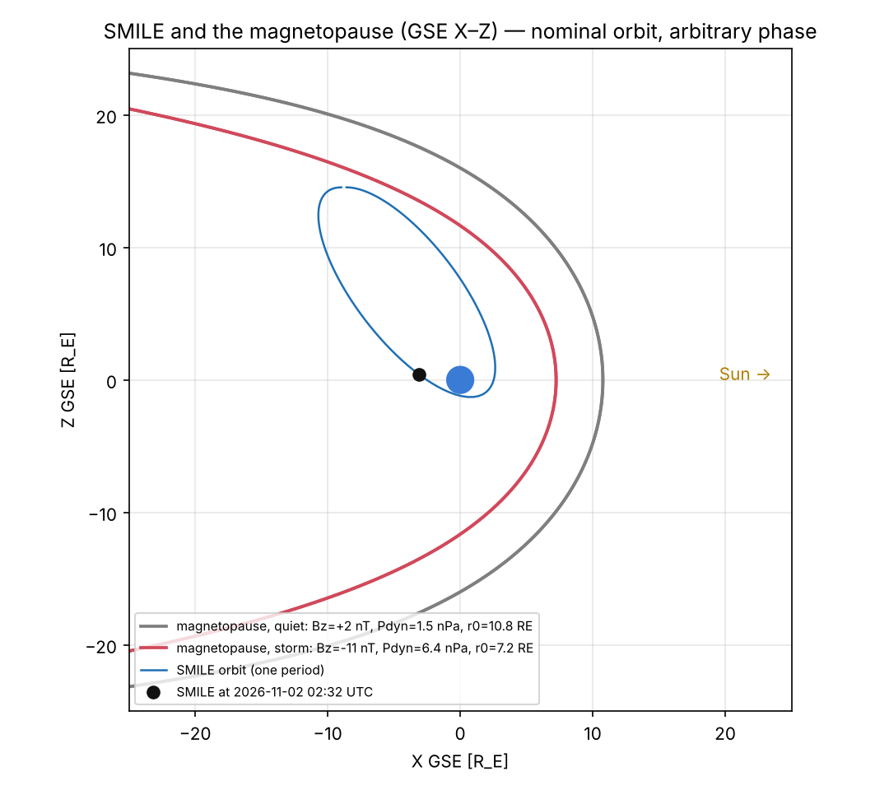

# SMILE Companion

**Where is ESA–CAS SMILE right now, and what is the solar wind doing to the magnetosphere it images?**

A small Python dashboard and toolkit built around the
[SMILE](https://www.cosmos.esa.int/web/smile) mission (Solar wind Magnetosphere Ionosphere Link Explorer),
launched on 19 May 2026 on a Vega-C. It puts SMILE's orbit, the upstream solar wind, and a model
magnetopause on one page, so you can see when SMILE sits outside the magnetopause looking back at the
compressed dayside, which is exactly what its soft X-ray imager (SXI) was built to do.



*Figure made in offline demo mode: SMILE's nominal science orbit (arbitrary phase) against a quiet and a
storm-time magnetopause from synthetic solar wind. Live mode uses the real TLE and real data.*

## What it shows

| Panel | What | Source |
|---|---|---|
| Where is SMILE? | Altitude, ground track, position in GSE | CelesTrak TLE for NORAD 69123, SGP4/SDP4 |
| Inside or outside? | Signed distance from SMILE to the model magnetopause | Shue et al. (1998) driven by the solar wind |
| Solar-wind driver | Speed, density, IMF Bz, dynamic pressure | NOAA SWPC real-time (L1), or NASA OMNI 1-min |
| Magnetosphere response | Subsolar standoff distance r0, SYM-H, Kp | Shue (1998); OMNI; GFZ Potsdam |
| LEO impact | Upload your own drag/decay series and overlay it on Kp | your CSV |

### Three modes

- **Live**: latest TLE, last 6 h–7 days of real-time solar wind, Kp nowcast.
- **Case study**: any past interval with OMNI 1-min data, e.g. the 23–24 April 2023 G4 storm. Intervals
  before launch replay SMILE's current orbit to show what it *would* have seen.
- **Offline demo**: the nominal orbit plus **synthetic** storm-like solar wind, so everything runs without
  internet. The app labels this data as synthetic.

## Quick start

```bash
git clone https://github.com/<you>/smile-companion.git
cd smile-companion
python -m venv .venv && source .venv/bin/activate      # Windows: .venv\Scripts\activate
pip install -r requirements.txt

streamlit run app.py                                     # dashboard in your browser
python scripts/make_figures.py --demo                    # static PNGs, no network
python scripts/make_figures.py --start 2023-04-23 --end 2023-04-25   # real storm, OMNI + Kp
python scripts/make_figures.py --start 2026-11-01 --end 2026-11-03 --live-tle
pytest -q                                                # offline tests
```

## Repository layout

```
smile-companion/
├── app.py                     Streamlit dashboard
├── smile_companion/
│   ├── config.py              NORAD ID, nominal orbit, data-source URLs
│   ├── orbit.py               TLE parsing, SGP4 / Kepler propagation, ECI→GSE and ground track
│   ├── magnetopause.py        Shue (1998) magnetopause, dynamic pressure, bow-shock standoff
│   ├── spaceweather.py        SWPC, OMNI (CDAWeb HAPI) and GFZ Kp fetchers + parsers
│   ├── demo.py                synthetic storm for offline use
│   └── figures.py             matplotlib quick-looks
├── scripts/make_figures.py    command-line figures
├── tests/test_smile.py        offline tests (physics, frames, parsers)
└── docs/figures/              README images
```

## Methods in brief

**Orbit.** SGP4/SDP4 from the latest TLE (SMILE's ~51 h period puts it in the deep-space SDP4 branch).
Without a TLE, or without the `sgp4` package, a two-body Kepler propagator is used. Positions are rotated into
GSE (X toward the Sun, Z to ecliptic north) with a low-precision solar ephemeris (~0.01°), which is plenty
for a 20 R<sub>E</sub> picture.

**Magnetopause.** Shue et al. (1998):

r(θ) = r₀ (2 / (1 + cos θ))^α,  r₀ = (10.22 + 1.29 tanh(0.184 (B<sub>z</sub> + 8.14))) D<sub>p</sub><sup>−1/6.6</sup>,
α = (0.58 − 0.007 B<sub>z</sub>)(1 + 0.024 ln D<sub>p</sub>)

with dynamic pressure D<sub>p</sub> = 2×10⁻⁶ n v² nPa (OMNI convention). The "inside/outside" metric is
SMILE's radial distance from that surface, reported only within 120° of the Sun–Earth line; the model
surface flares open in the tail.

**Data caveats.** SWPC real-time data are measured at L1 and *not* time-shifted (they reach Earth roughly
30–60 min later), while OMNI is already propagated to the bow-shock nose. Kp is 3-hourly; SYM-H (OMNI only)
is the 1-minute ring-current proxy.

## Roadmap

- [x] Orbit tracker, solar wind, Shue magnetopause, Kp, offline demo
- [ ] Bow-shock surface and magnetosheath region on the orbit plot
- [ ] Mark when SMILE is near apogee *and* the dayside is compressed (best SXI imaging windows)
- [ ] Case-study gallery: April 2023 G4 and May 2024 G5 storms
- [ ] Link LEO drag/decay series from `leo-storm-decay` to the same storms
- [ ] SXI/UVI quick-look products once the SMILE archive releases them

## References

- Shue, J.-H. et al. (1998). Magnetopause location under extreme solar wind conditions. *JGR* 103(A8), 17691.
- Farris, M. H. & Russell, C. T. (1994). Determining the standoff distance of the bow shock. *JGR* 99(A9), 17681.
- Vallado, D. A. et al. (2006). Revisiting Spacetrack Report #3. AIAA 2006-6753.
- Branduardi-Raymont, G. et al. (2018). SMILE definition study report, ESA/SCI(2018)1.
- ESA SMILE operations: <https://www.cosmos.esa.int/web/smile/operations>

Data: [CelesTrak](https://celestrak.org), [NOAA SWPC](https://www.swpc.noaa.gov),
[NASA OMNIWeb/CDAWeb](https://omniweb.gsfc.nasa.gov), [GFZ Potsdam Kp](https://kp.gfz-potsdam.de).

## License

MIT
